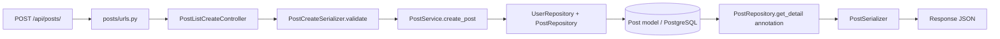

# Mini Social Network

Project bài tập mạng xã hội mini, chạy local hoặc triển khai frontend lên Vercel và backend ASGI lên Render. Backend dùng Django REST Framework, PostgreSQL và Django Channels; frontend dùng React/Vite. Ảnh avatar và ảnh bài viết được upload lên Cloudinary, PostgreSQL chỉ lưu secure URL/public_id. Code được chia tầng rõ ràng theo luồng bắt buộc:

`urls → controller → serializer → service → repository → model`

Hỗ trợ chạy trực tiếp (local) hoặc chạy qua **Docker & Redis**. Khi có cấu hình Redis (qua Docker hoặc biến môi trường `REDIS_HOST`/`REDIS_URL`), Django Channels sẽ dùng `channels_redis` phục vụ WebSocket chat và thông báo realtime cũng như cache; khi chạy local không có Redis, hệ thống tự động fallback an toàn về `InMemoryChannelLayer`.

## 0. Chạy nhanh toàn bộ hệ thống bằng Docker & Redis (Khuyên dùng)

Hệ thống đã được đóng gói đầy đủ trong `docker-compose.yml` gồm 4 dịch vụ:
- **db**: PostgreSQL 16 (port host: `5433` để tránh trùng lặp nếu máy đã chạy PostgreSQL 5432)
- **redis**: Redis 7 Alpine (port host: `6379`)
- **backend**: Django ASGI / Daphne (port host: `8000`), tự động đợi DB & Redis sẵn sàng và chạy migration
- **frontend**: React Vite Dev Server (port host: `5173`) hỗ trợ hot-reload khi chỉnh sửa code

### Lệnh khởi chạy:

```powershell
# Khởi động toàn bộ các service ở chế độ nền
docker compose up -d --build

# Xem log các service
docker compose logs -f

# Tạo tài khoản quản trị (superuser) trong container backend
docker compose exec backend python manage.py createsuperuser

# Dừng hệ thống
docker compose down
```

Sau khi khởi chạy:
- Frontend: [http://localhost:5173](http://localhost:5173)
- Backend API: [http://localhost:8000/api](http://localhost:8000/api)
- Django Admin: [http://localhost:8000/admin](http://localhost:8000/admin)

---

## 1. Cấu trúc chính

```text
backend/
  manage.py
  requirements.txt
  .env.example
  config/              # settings, urls, ASGI/WSGI
  core/                # exception, pagination, permission, storage adapter
  accounts/            # User, auth, profile
  posts/               # Post, Comment, Like
  chat/                # Conversation, Message, REST + WebSocket
  notifications/       # Notification, REST + WebSocket
frontend/
  .env.example        # URL API, WebSocket và backend origin
  vercel.json         # rewrite cho React Router SPA
  src/
    config/            # đọc và chuẩn hóa biến môi trường Vite
    api/               # axios request
    services/          # API, upload validation, media URL và logic gọi API
    hooks/             # useAuth, usePosts, useChat, useNotifications
    context/           # AuthContext
    components/        # Navbar, Avatar, PostCard, PostForm
    pages/              # Login, Register, Feed, PostDetail, Profile, Chat
    routes/             # AppRouter
```

Mỗi app backend đều có các thư mục `models/`, `repositories/`, `services/`, `serializers/`, `controllers/` và `__init__.py` export class. Repository là nơi duy nhất truy vấn ORM; service không gọi `.objects` trực tiếp.

## 2. Tạo database PostgreSQL

Mở psql hoặc pgAdmin bằng user có quyền tạo database:

```sql
CREATE DATABASE mini_social;
```

Nếu PostgreSQL của bạn dùng user/password khác, cập nhật các giá trị trong file `.env` ở bước kế tiếp.

## 3. Chạy backend

PowerShell:

```powershell
cd backend
python -m venv .venv
.\.venv\Scripts\Activate.ps1
python -m pip install --upgrade pip
pip install -r requirements.txt
Copy-Item .env.example .env
```

Mở `backend/.env`, cấu hình `DB_NAME`, `DB_USER`, `DB_PASSWORD`, `DB_HOST`, `DB_PORT`. Khi chạy local giữ `DB_SSLMODE=disable`, rồi chạy:

```powershell
python manage.py migrate
python manage.py createsuperuser
python manage.py runserver 8000
```

Project đã kèm đầy đủ migration, gồm model Friendship/Notification và migration dữ liệu giữ quan hệ chat cũ; không sửa/xóa migration cũ. Có thể kiểm tra không còn migration thiếu bằng `python manage.py makemigrations --check --dry-run`.

`runserver` của Django hỗ trợ ASGI khi có Daphne trong `INSTALLED_APPS`. Chat dùng room socket `ws://localhost:8000/ws/chat/<conversation_id>/?token=<access_token>`, sidebar socket `ws://localhost:8000/ws/chat/sidebar/?token=<access_token>` và thông báo dùng `ws://localhost:8000/ws/notifications/?token=<access_token>`.

Cloudinary được cấu hình bằng ba biến `CLOUDINARY_CLOUD_NAME`, `CLOUDINARY_API_KEY`, `CLOUDINARY_API_SECRET`. Mỗi ảnh phải là JPEG, PNG, WEBP hoặc GIF và không lớn hơn 5 MB. `avatar_url`/`image_url` tiếp tục là tên field API, còn `avatar_public_id`/`image_public_id` dùng để xóa ảnh cũ.

Nếu chưa có credentials Cloudinary, backend vẫn chạy được nhưng endpoint upload sẽ trả lỗi cấu hình storage. Không ghi credentials thật vào `.env.example` hoặc commit vào source.

## 4. Chạy frontend

Mở terminal thứ hai:

```powershell
cd frontend
npm install
Copy-Item .env.example .env
npm run dev
```

Truy cập [http://localhost:5173](http://localhost:5173). Các biến trong `frontend/.env` mặc định trỏ tới local; nếu không tạo file này, code cũng dùng cùng fallback localhost. Frontend lưu access/refresh token ở `localStorage`.

| Biến frontend | Giá trị local | Mục đích |
|---|---|---|
| `VITE_API_BASE_URL` | `http://localhost:8000/api` | REST API và refresh token |
| `VITE_WS_BASE_URL` | `ws://localhost:8000` | WebSocket chat |
| `VITE_BACKEND_ORIGIN` | `http://localhost:8000` | Ghép các media URL tương đối |

URL Cloudinary tuyệt đối (`https://...`) được giữ nguyên. Trên production, đặt `VITE_WS_BASE_URL` thành `wss://...`; code cũng tự chuyển `https://` thành `wss://` nếu nhập nhầm scheme HTTP.

Project không kèm dữ liệu mẫu hoặc tài khoản mẫu. Sau khi migrate, tạo tài khoản bằng giao diện Register hoặc dùng `createsuperuser` cho Django Admin.

## 4.1. Xử lý lỗi PostgreSQL thường gặp

Nếu gặp:

```text
FATAL: password authentication failed for user "postgres"
```

PostgreSQL đã chạy nhưng `DB_USER`/`DB_PASSWORD` trong `backend/.env` chưa đúng. Cập nhật lại các giá trị này theo user PostgreSQL local của bạn, rồi chạy lại:

```powershell
python manage.py migrate
```

Không đổi sang SQLite vì project bắt buộc dùng PostgreSQL.

## 5. API endpoints

Tất cả endpoint dưới đây trừ auth công khai cần header `Authorization: Bearer <access_token>`.

| Method | Path | Mô tả |
|---|---|---|
| POST | `/api/accounts/register/` | Đăng ký, trả access + refresh + user |
| POST | `/api/accounts/login/` | Đăng nhập JWT |
| POST | `/api/accounts/refresh/` | Lấy access token mới từ refresh |
| POST | `/api/accounts/logout/` | Logout phía client, trả success |
| GET | `/api/accounts/me/` | Xem profile của mình |
| PATCH | `/api/accounts/me/` | Cập nhật email/avatar_file/bio bằng `multipart/form-data` |
| GET | `/api/accounts/friends/` | Danh sách bạn bè được phép chat |
| POST | `/api/accounts/friend-requests/` | Gửi lời mời với `{ "user_id": 2 }` |
| POST | `/api/accounts/friend-requests/<id>/accept/` | Chấp nhận lời mời kết bạn |
| DELETE | `/api/accounts/friend-requests/<id>/` | Từ chối hoặc hủy lời mời đang chờ |
| GET | `/api/posts/` | Newsfeed mới nhất trước, phân trang `?page=1` |
| POST | `/api/posts/` | Tạo bài text + image_file bằng `multipart/form-data` |
| GET | `/api/posts/<id>/` | Xem chi tiết bài |
| DELETE | `/api/posts/<id>/` | Xóa bài của chính mình |
| POST | `/api/posts/<id>/like/` | Toggle like/unlike |
| GET | `/api/posts/<id>/comments/` | Danh sách comment |
| POST | `/api/posts/<id>/comments/` | Tạo comment |
| GET | `/api/chat/conversations/` | Danh sách cuộc trò chuyện của mình |
| POST | `/api/chat/conversations/` | Tạo/mở chat với một username đã là bạn bè |
| GET | `/api/chat/conversations/<id>/messages/` | Load lịch sử tin nhắn |
| GET | `/api/notifications/` | Danh sách thông báo và tổng chưa đọc |
| POST | `/api/notifications/<id>/read/` | Đánh dấu một thông báo đã đọc |
| POST | `/api/notifications/read-all/` | Đánh dấu tất cả đã đọc |

WebSocket:

```text
ws://localhost:8000/ws/chat/<conversation_id>/?token=<access_token>
ws://localhost:8000/ws/chat/sidebar/?token=<access_token>
ws://localhost:8000/ws/notifications/?token=<access_token>
```

Gửi JSON `{ "content": "Xin chào" }` vào room socket. Server trả các event `message.created` và `messages.read`; sidebar socket nhận `conversation.updated`; socket thông báo phát `notifications.changed` để frontend tải lại badge/danh sách. `read_at` được lưu trong PostgreSQL nên trạng thái “Đã gửi/Đã xem” không mất khi reload. Backend kiểm tra quan hệ bạn bè ở service cho cả REST lẫn WebSocket.

Khi upload, frontend gửi `multipart/form-data` với `avatar_file` cho profile hoặc `image_file` cho bài viết. Không tự đặt header `Content-Type`, để axios tự tạo boundary cho FormData.

## 6. Luồng request mẫu: tạo bài đăng



Controller chỉ lấy `request`, chạy serializer, gọi service và tạo `Response`. Service kiểm tra user rồi gọi repository. Repository tạo Post bằng ORM và query lại dữ liệu có số like/comment. Model chỉ khai báo entity.

## 7. Tự review trước khi chạy

- Đã có custom User kế thừa `AbstractUser`, `AUTH_USER_MODEL`, JWT login/refresh và token interceptor phía React.
- Các model User, Friendship, Post, Comment, Like, Conversation, Message và Notification đã có migration và đăng ký trong Django Admin.
- Upload avatar/ảnh bài viết dùng CloudinaryStorage, preview phía React, validate MIME/extension/size ở cả frontend và backend, và tự dọn file cũ an toàn.
- CORS/CSRF/hosts được đọc từ biến môi trường, mặc định chỉ cho local và không bật allow-all.
- Quyền xóa bài kiểm tra ở service; chat kiểm tra participant và quan hệ bạn bè ở service; profile chỉ thao tác trên `request.user`.
- Like, comment, gửi/chấp nhận kết bạn tạo thông báo; bỏ like xóa thông báo like tương ứng.
- Các app có đầy đủ migration, gồm friendship, notification, Cloudinary và chat read receipt; lệnh `makemigrations --check --dry-run` hiện không phát hiện thay đổi thiếu.
- Backend không dùng Redis/Celery/Docker; Channels cấu hình `InMemoryChannelLayer`.
- Cần giữ backend và frontend chạy đồng thời. `InMemoryChannelLayer` không chia sẻ tin nhắn giữa nhiều process/instance, nên không tăng số instance hoặc worker backend.

## 8. Chuẩn bị repository GitHub

Trước khi push, kiểm tra các file thật như `backend/.env`, `frontend/.env`, virtual environment, `node_modules`, media local và thư mục build không xuất hiện trong commit:

```powershell
git status --short
git check-ignore -v backend/.env frontend/.env backend/.venv frontend/node_modules frontend/dist
```

Chỉ commit `backend/.env.example` và `frontend/.env.example`. Không đặt password PostgreSQL, Django `SECRET_KEY`, Cloudinary API secret hoặc token thật trong source, README, commit hay biến `VITE_*`. Mọi biến `VITE_*` đều được đưa vào bundle trình duyệt nên chỉ dùng cho URL công khai.

## 9. Deployment production

### 9.1. Push GitHub

Project hiện chỉ được chuẩn bị file và cấu hình; người dùng tự tạo repository GitHub rồi chạy các lệnh Git phù hợp. Nếu thư mục chưa là Git repository:

```powershell
git init
git add .
git status
git commit -m "Prepare Mini Social for deployment"
git branch -M main
git remote add origin <github-repository-url>
git push -u origin main
```

Luôn xem lại `git status` trước commit để chắc chắn `.env`, virtualenv, `node_modules`, `dist`, `media` và `staticfiles` không được stage.

### 9.2. Tạo PostgreSQL production

Có thể dùng Neon hoặc Render PostgreSQL. Project đọc từng thành phần kết nối, không cần thêm package đọc `DATABASE_URL`.

1. Tạo database PostgreSQL trên nhà cung cấp.
2. Từ thông tin kết nối, sao chép đúng database name, user, password, host và port vào các biến Render `DB_NAME`, `DB_USER`, `DB_PASSWORD`, `DB_HOST`, `DB_PORT`.
3. Đặt `DB_SSLMODE=require` trên production.
4. Không đưa các giá trị thật vào `.env.example`.

Nếu nhà cung cấp chỉ hiển thị connection string, tách các phần user, password, host, port và database name thành các biến trên. Với mật khẩu có ký tự đặc biệt, ưu tiên dùng các trường thông tin riêng do dashboard cung cấp để tránh nhầm phần đã URL-encode.

Dữ liệu PostgreSQL local **không tự chuyển** lên production. Lệnh `migrate` chỉ tạo cấu trúc bảng; muốn có dữ liệu cũ phải xuất/nhập dữ liệu riêng và tự kiểm soát tính tương thích.

### 9.3. Deploy backend lên Render

Tạo **Web Service** từ GitHub repository với cấu hình:

| Mục | Giá trị |
|---|---|
| Root Directory | `backend` |
| Runtime | Python |
| Build Command | `pip install -r requirements.txt && python manage.py collectstatic --noinput && python manage.py migrate` |
| Start Command | `daphne -b 0.0.0.0 -p $PORT config.asgi:application` |
| Health check (tùy chọn) | Không đặt nếu chưa có endpoint health riêng |
| Scaling | 1 instance, không tăng số process |

Khai báo các biến môi trường sau trong Render:

| Biến | Giá trị production |
|---|---|
| `SECRET_KEY` | Chuỗi bí mật dài, ngẫu nhiên, chỉ lưu trên Render |
| `DEBUG` | `False` |
| `ALLOWED_HOSTS` | Hostname backend, không gồm `https://`, ví dụ `<backend>.onrender.com` |
| `CORS_ALLOWED_ORIGINS` | Origin frontend đầy đủ, ví dụ `https://<frontend>.vercel.app` |
| `CSRF_TRUSTED_ORIGINS` | Origin frontend đầy đủ, ví dụ `https://<frontend>.vercel.app` |
| `DB_NAME`, `DB_USER`, `DB_PASSWORD`, `DB_HOST`, `DB_PORT` | Thông tin PostgreSQL production |
| `DB_SSLMODE` | `require` |
| `CLOUDINARY_CLOUD_NAME`, `CLOUDINARY_API_KEY`, `CLOUDINARY_API_SECRET` | Credentials Cloudinary production |

`DEBUG=False` bắt buộc phải có `SECRET_KEY` mạnh; settings sẽ chủ động dừng ứng dụng nếu còn dùng giá trị mẫu yếu. Django tin cậy proxy HTTPS của Render, chuyển hướng HTTP sang HTTPS và bật secure cookies khi production. WhiteNoise phục vụ static đã collect để trang Django Admin có CSS khi Daphne chạy ASGI.

Cloudinary API secret chỉ lưu trong Environment của Render, không đưa sang Vercel. Render Free có thể cold start sau thời gian không hoạt động, vì vậy request API/WebSocket đầu tiên đôi lúc chậm hơn; đây không phải lỗi frontend.

Build command ở trên chạy migration sau khi cài package và collect static, phù hợp cách triển khai đơn giản/một instance của bài tập. Hạn chế là migration thuộc build phase: nếu có nhiều deploy đồng thời hoặc migration lỗi, build sẽ thất bại. Với gói Render hỗ trợ **Pre-Deploy Command**, nên chuyển `python manage.py migrate` sang bước đó và bỏ khỏi Build Command; tính năng pre-deploy không có trên mọi loại dịch vụ/gói.

Như vậy migration production được chạy tự động trong Build Command. Nếu đã chuyển sang Pre-Deploy Command, cấu hình chính xác `python manage.py migrate` tại đó. Không chạy hai deploy cùng lúc.

Sau lần deploy đầu, tạo superuser production bằng Render Shell (nếu gói đang dùng hỗ trợ):

```bash
python manage.py createsuperuser
```

Nếu không có Render Shell, có thể chạy `manage.py createsuperuser` từ máy local với các biến database production chỉ được đặt tạm trong terminal hiện tại và `DB_SSLMODE=require`. Không ghi chúng vào file được commit, không đặt password trực tiếp trong câu lệnh hoặc lịch sử shell.

Sau khi deploy, kiểm tra:

- `https://<backend>.onrender.com/admin/` tải đủ CSS.
- API đăng nhập, feed, kết bạn và thông báo trả response bình thường.
- Render service chỉ có một instance để `InMemoryChannelLayer` hoạt động nhất quán.

### 9.4. Deploy frontend lên Vercel

Tạo project Vercel từ cùng GitHub repository:

| Mục | Giá trị |
|---|---|
| Root Directory | `frontend` |
| Framework Preset | Vite |
| Build Command | `npm run build` |
| Output Directory | `dist` |

Khai báo biến môi trường production trước khi deploy:

```text
VITE_API_BASE_URL=https://<backend>.onrender.com/api
VITE_WS_BASE_URL=wss://<backend>.onrender.com
VITE_BACKEND_ORIGIN=https://<backend>.onrender.com
```

Không thêm dấu `/` cuối URL; code vẫn tự loại bỏ nếu có. `frontend/vercel.json` rewrite mọi route về `index.html`, vì vậy reload trực tiếp ở `/chat`, `/profile` hoặc trang chi tiết bài không bị 404.

Vercel chỉ cần và chỉ nên nhận ba biến công khai: `VITE_API_BASE_URL`, `VITE_WS_BASE_URL`, `VITE_BACKEND_ORIGIN`. Không sao chép `SECRET_KEY`, thông tin PostgreSQL hay Cloudinary secret sang Vercel.

Sau khi Vercel cấp domain thật, quay lại Render cập nhật `CORS_ALLOWED_ORIGINS` và `CSRF_TRUSTED_ORIGINS` bằng origin Vercel chính xác rồi redeploy backend. Nếu có nhiều domain preview, chỉ thêm những origin thực sự cần dùng, phân tách bằng dấu phẩy; không bật CORS cho toàn bộ origin.

### 9.5. Cập nhật CORS/CSRF và kiểm tra sau triển khai

1. Đăng ký/đăng nhập, refresh trang và xác nhận token refresh gọi đúng backend production.
2. Tạo bài có chữ/emoji/ảnh, mở Feed và Post Detail, kiểm tra ảnh Cloudinary.
3. Cập nhật avatar và bio.
4. Tài khoản A gửi lời mời từ bài viết; tài khoản B nhận badge realtime, chấp nhận và kiểm tra cả hai thấy nhau trong Chat.
5. Like/comment bài của tài khoản khác và kiểm tra thông báo realtime.
6. Mở hai tài khoản ở hai cửa sổ, vào cùng hội thoại và gửi tin nhắn realtime qua `wss://`.
7. Reload trực tiếp các route React để xác nhận rewrite SPA.
8. Mở Django Admin và kiểm tra CSS static.
9. Xem console/network của trình duyệt, bảo đảm không còn request tới localhost, lỗi CORS hoặc mixed content.

Trước mỗi lần push quan trọng có thể chạy lại:

```powershell
.\backend\.venv\Scripts\python.exe backend\manage.py check
.\backend\.venv\Scripts\python.exe backend\manage.py makemigrations --check --dry-run
cd frontend
npm run build
```
